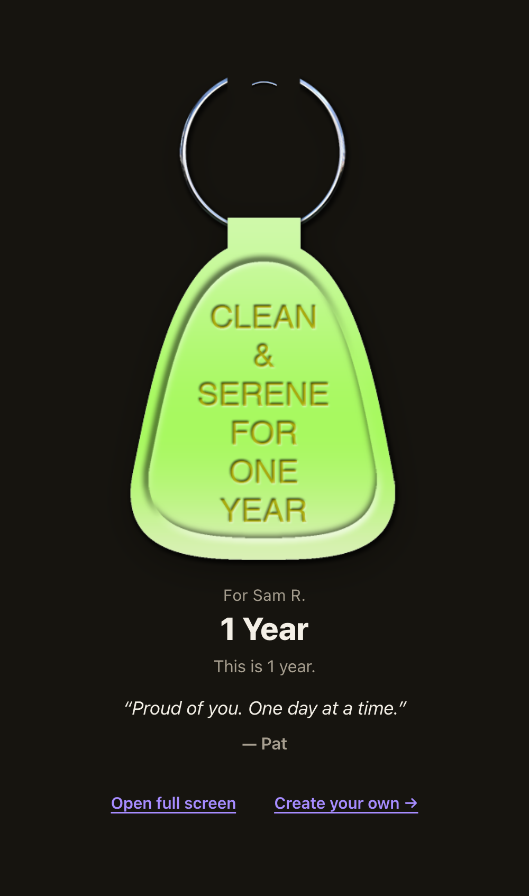

  

<h1 align="center">Virtual Keytags</h1>

  
  
  
  

  <strong>👉 Try it:</strong> <a href="https://keytags.bmlt.app/">keytags.bmlt.app</a>

  

Send someone a virtual NA clean-time keytag — a keepsake card celebrating a milestone — or
put one full-screen on screen-share during an online meeting. No apps, no sign-up.

## How it works

1. **Pick a milestone** — or enter a clean date and the right tag is chosen for you.
2. **Make it personal** — add a name and a short message.
3. **Send it** — share the link, or download it as an image.

**🔒 Private by design.** No accounts, no server, nothing stored. The whole card lives
inside the link you share, so it exists only where you send it — in keeping with NA's
tradition of anonymity.

## Features

- **Send a keytag** as a shareable link or a downloadable image
- **Flip card** — the tag hangs from the ring and flips to reveal the reading
- **Display view** — a full-screen tag for Zoom / online-meeting celebrations
- **6 languages** — English, Español, Português, Italiano, 简体中文, 繁體中文
- **Specialty long-term tags** — optional 5 / 10 / 15 / 25 / 30-year tags
- Works on phone and desktop, light and dark

## Need help?

- 🐛 **Bug or idea:** open an issue on [GitHub](https://github.com/bmlt-enabled/keytags/issues)
- 📧 **Email:** [help@bmlt.app](mailto:help@bmlt.app)
- 💬 **Community:** the [BMLT Facebook group](https://www.facebook.com/groups/bmltapp/)

## Contributing

Dev setup, architecture, and deploy notes are in
[`.github/CONTRIBUTING.md`](.github/CONTRIBUTING.md).

## License

MIT
